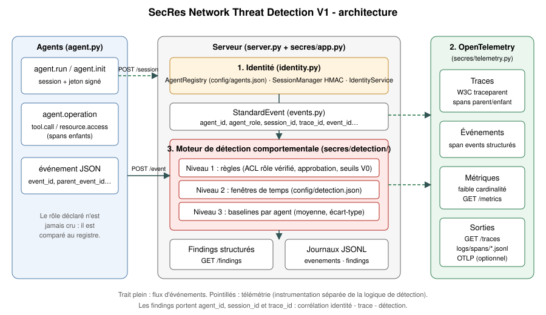
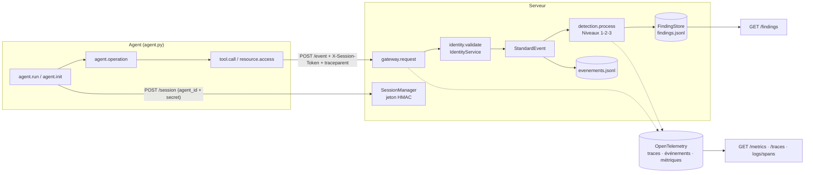

# Architecture V1

## Responsabilités

| Composant | Fichiers | Rôle | Ne fait pas |
|---|---|---|---|
| Identité | `secres/identity.py`, `secres/events.py`, `config/agents.json` | Authentifie les agents, attribue rôle et session, signe les jetons, signale les déclarations incohérentes | Ne décide pas du blocage |
| Télémétrie | `secres/telemetry.py` | Spans, événements structurés, métriques, propagation W3C | N'importe pas le moteur de détection ; le moteur n'importe pas la télémétrie |
| Détection | `secres/detection/*`, `config/detection.json`, `config/access_control.json` | Niveaux 1-3, findings structurés | N'authentifie pas, n'émet aucune métrique |
| Orchestration | `secres/app.py`, `server.py` | Enchaîne identité, télémétrie et détection ; API HTTP | |

## Flux d'un événement
1. `POST /session` : l'agent présente `agent_id` + secret ; le serveur compare au haché du registre, attribue le **rôle du registre** et renvoie `session_id` + jeton signé HMAC-SHA256.
2. L'agent ouvre `agent.operation` puis un span enfant (`tool.call` ou `resource.access`), injecte `traceparent` et envoie l'événement avec `X-Session-Token`.
3. Le serveur extrait le contexte (`gateway.request` devient enfant du span de l'agent), vérifie la signature, l'expiration, la session et la cohérence avec le registre. Chaque écart (rôle déclaré, agent_id, session_id, trace_id, rejeu d'`event_id`) devient un drapeau d'identité.
4. L'événement est converti en `StandardEvent` (identité vérifiée uniquement) et passé au moteur dans `detection.process`.
5. Le moteur renvoie des findings ; la décision est `refuser` (au moins un finding de niveau 1, comme en V0), `alerte` (niveaux 2-3 seulement) ou `autoriser`.
6. Journal JSONL (format V0 + bloc `identite`), métriques, span events et findings (corrélés par `agent_id`, `session_id`, `trace_id`).

## Niveaux de détection

| Niveau | Détecteurs (`detection_type`) | Réglage |
|---|---|---|
| 1 règles | `unauthorized_resource_access`, `unauthorized_tool_usage`, `invalid_operation`, `approval_bypass`, `suspicious_action`, `data_exfiltration_suspected`, `tool_abuse_frequency`, `repeated_sensitive_operations`, `identity_unverified`, `identity_spoofing`, `replayed_event`, `trace_mismatch` | `level1`, `access_control.json` |
| 2 fenêtres | `excessive_data_reads`, `customer_record_volume`, `repeated_payment_api_calls`, `abnormal_tool_frequency`, `suspicious_sequence`, `gradual_exfiltration` | `time_window` |
| 3 baselines | `baseline_deviation` (`new_resource`, `new_tool`, `quantity_outlier`, `rate_spike`) | `baseline` |

Baseline : par `agent_id`, après `min_events` événements propres, comparaison à la moyenne/écart-type (Welford) des quantités par ressource et du débit glissant ; seuil `z_threshold`, plancher d'écart-type `min_std`. Les événements anormaux ne sont pas appris.
